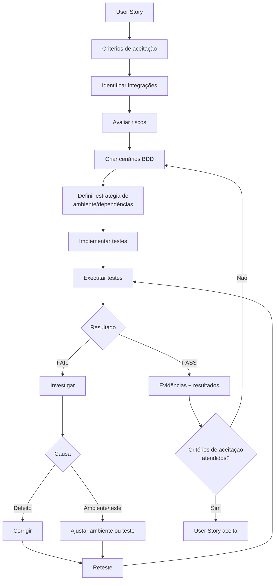

# Testes de Integração com BDD — Metodologia e Padrão de Implementação
---

## 1. O que é um teste de integração

Um teste de integração valida se **dois ou mais componentes reais do sistema funcionam corretamente quando conectados entre si** — ao contrário do teste unitário (que isola uma classe/método, normalmente com dependências mockadas).
No nosso projeto, isso normalmente significa: subir o contexto real da aplicação Spring, fazer uma chamada HTTP de verdade contra um controller (via MockMvc), deixar essa chamada atravessar o service, a camada de consulta (Specification/JPA Criteria) e chegar a um banco de dados real — e então verificar a resposta.

| Tipo de teste | O que valida | Isolamento |
|---|---|---|
| **Unitário** | Uma unidade de lógica isolada (uma classe, um método) | Dependências mockadas |
| **Integração** | A interação real entre componentes internos (Controller → Service → Repository) | Banco real ou equivalente; sem mocks das camadas internas |

Um teste de integração não existe para provar que uma classe está certa isoladamente — existe pra provar que a **fronteira** entre componentes (ex.: a query gerada pelo Specification realmente traz o resultado certo do banco) funciona como esperado. Por isso, ao planejar um teste de integração, a primeira pergunta é sempre: **qual fronteira entre componentes estou validando aqui?**, não "qual classe estou testando?".

---

## 2. Metodologia BDD (Behavior-Driven Development)

### 2.1 O que é

BDD é uma forma de descrever o comportamento esperado de um sistema através de **exemplos concretos e observáveis externamente**, em vez de descrever como o código foi implementado por dentro. A ideia central: qualquer pessoa do time — dev, QA, PO — deve conseguir ler um cenário e entender exatamente o que o sistema deve fazer, sem precisar abrir o código-fonte.

O formato padrão para descrever esses exemplos é **Given / When / Then** (e o complemento `And`):

- **Given** — o estado do mundo antes da ação (quais dados existem, em que condição).
- **When** — a ação/evento único que o comportamento descreve.
- **Then** — o resultado esperado, sempre **observável de fora** (resposta HTTP, corpo retornado) — nunca uma verificação de como a implementação funciona por dentro.
- **And** — complementa qualquer um dos três blocos anteriores quando há mais de uma condição/ação/verificação no mesmo cenário.

Regra de ouro: se o `Then` só pode ser verificado abrindo o código-fonte (em vez de fazendo a chamada e olhando a resposta), ele está descrevendo implementação, não comportamento — e está errado. Prefira sempre:

> "Then o sistema deve retornar os resultados relacionados ao termo pesquisado"

em vez de:

> "Then o SearchService deve chamar o Repository"

### 2.2 Exemplo aplicado

Pegando uma necessidade real da Sprint 1 (US02 — submeter descrição do caso para buscar conteúdo jurídico relacionado):

```text
Cenário: deve retornar jurisprudências cujo texto contém o termo pesquisado

Given: uma decisão judicial ativa com o termo "dano moral" no título/ementa,
       e outra decisão ativa sem esse termo

When: o usuário pesquisar pelo termo "dano moral"

Then: o sistema deve retornar apenas a decisão compatível
And: a resposta deve indicar a sigla da fonte de origem daquela decisão
```

Note que nada aqui fala de `Controller`, `Service`, `Specification` ou `Repository` — fala só do que o usuário pediu e do que ele deve receber de volta. A tradução disso para código (Seção 5) é que vai cuidar de qual componente participa de cada parte.

### 2.3 BDD como critério de aceite

Este é o ponto mais importante deste documento: **os cenários BDD não são "só testes" — eles SÃO os critérios de aceitação de cada User Story.**

Isso muda a forma como uma User Story é considerada pronta:

- Uma US não está aceita só porque "o código compila" ou porque "parece funcionar manualmente".
- Uma US está aceita quando **todo cenário BDD derivado dela passa**, de forma automatizada e repetível.
- Se durante a implementação surge um comportamento que não está coberto por nenhum cenário BDD já escrito, isso é sinal de que falta um cenário — não uma exceção que pode ser ignorada.

Na prática: o cenário BDD escrito na etapa de planejamento (antes de qualquer código) é o **contrato** entre "o que foi pedido" e "o que foi entregue". O teste automatizado é apenas a forma como esse contrato é verificado a cada vez que o código muda.

---

## 3. Fluxo de desenvolvimento orientado a testes de integração

Este é o fluxo que a equipe segue, da User Story até a aceitação:



### O que acontece em cada etapa

1. **User Story** — ponto de partida: uma necessidade de negócio, ainda sem detalhamento técnico.
2. **Critérios de aceitação** — a US é reescrita em termos observáveis (Given/When/Then de alto nível), sem ainda entrar em cenários de borda.
3. **Identificar integrações** — mapeia-se quais fronteiras reais entre componentes (Controller↔Service, Service↔Repository, aplicação↔banco, etc.) precisam funcionar para que o critério de aceitação seja cumprido. Nem toda chamada entre classes é uma integração relevante — só as fronteiras que, se quebrarem, quebram o comportamento observável.
4. **Avaliar riscos** — para cada integração identificada, pergunta-se: o que pode dar errado? (entrada inválida, ausência de dados, dependência externa fora do ar, timeout, dado incompleto, etc.). O risco de cada ponto orienta quais cenários valem a pena escrever e com que prioridade.
5. **Criar cenários BDD** — cada risco relevante vira um cenário Given/When/Then concreto. Uma User Story normalmente gera vários cenários (caminho feliz, entrada inválida, ausência de resultado, etc.) — nunca só um.
6. **Definir estratégia de ambiente/dependências** — decide-se, cenário a cenário, o que precisa ser infraestrutura real (ex.: banco de dados) e o que pode ser simulado (ex.: uma API externa instável). Ver a lógica completa dessa decisão no documento de planejamento da Sprint 1.
7. **Implementar testes** — só agora o código do teste é escrito, seguindo o padrão descrito na Seção 5 deste documento.
8. **Executar testes** — a suíte roda, de forma automatizada.
9. **PASS / FAIL:**
   - **PASS** → segue direto para "Evidências + resultados".
   - **FAIL** → entra em **Investigar**, para descobrir se a causa é:
     - **Defeito real no código** → corrige o código-fonte;
     - **Problema de ambiente/teste** (dado de teste errado, configuração, timing) → ajusta o próprio teste ou o ambiente.
   - Em qualquer um dos dois casos, depois da correção roda-se um **reteste**, voltando para "Executar testes".
10. **Evidências + resultados** — depois de um PASS (seja na primeira execução ou após reteste), documenta-se o resultado (relatório de execução, cobertura, logs).
11. **Critérios de aceitação atendidos?** — verificação final: todos os cenários BDD derivados da US passaram?
    - **Sim** → **User Story aceita**.
    - **Não** → volta para "Criar cenários BDD": ou falta cenário (o comportamento que falhou não tinha sido previsto), ou o critério de aceitação em si precisa ser revisado com o time/PO.

---

## 4. Cenários BDD já criados — Sprint 1

Os cenários abaixo foram derivados das 10 User Stories da Sprint 1, seguindo exatamente o fluxo da Seção 3 (US → critério de aceitação → integrações → riscos → cenário BDD). Eles já orientaram a implementação do primeiro teste de integração do projeto (Seção 5.4).

> Cobertura completa (fronteiras de integração, matriz de testes, estratégia de Testcontainers/isolamento e lacunas) está no documento de planejamento da Sprint 1. Aqui ficam só os cenários BDD, como referência rápida do que já foi especificado.

### US01 — Buscar jurisprudência, precedentes e doutrina relacionados ao caso

```text
Cenário: busca por termo retorna itens das três categorias

Given: existem uma decisão, um precedente e uma doutrina ativos,
       cada um contendo a palavra "dano" em campo pesquisável

When: o usuário pesquisar por "dano" nas três categorias

Then: cada categoria retorna o respectivo item na lista de resultados
```

### US02 — Submeter descrição do caso para iniciar a busca

```text
Cenário: termo válido retorna resultados compatíveis
Given: uma decisão ativa com o termo pesquisado
When: o usuário pesquisar por esse termo
Then: o sistema retorna a decisão compatível

Cenário: termo com múltiplas palavras casa por qualquer palavra relevante
Given: uma decisão contendo apenas uma das palavras da descrição do caso
When: o usuário pesquisar usando a descrição completa
Then: o sistema retorna essa decisão

Cenário: termo excede 300 caracteres
Given: um termo de pesquisa com 301 caracteres
When: o usuário realizar a busca
Then: o sistema responde HTTP 400

Cenário: termo ausente retorna todos os documentos ativos
Given: existem documentos ativos cadastrados
When: o usuário pesquisar sem informar nenhum termo
Then: o sistema retorna todos os documentos ativos, sem aplicar filtro de texto

Cenário: caracteres especiais de SQL LIKE não quebram a busca
Given: um termo de pesquisa contendo os caracteres "%", "_" e "\"
When: o usuário realizar a busca
Then: o sistema responde normalmente, sem erro e sem resultado incorreto
```

### US03 — Visualizar os resultados da busca

```text
Cenário: resultado traz os campos obrigatórios
Given: a busca retornou documentos correspondentes
When: o usuário visualizar a lista de resultados
Then: cada item contém, no mínimo, título e um resumo/ementa
And: a resposta indica o total de resultados e a paginação

Cenário: nenhum documento corresponde ao termo pesquisado
Given: não existe nenhum documento compatível com o termo
When: o usuário realizar a busca
Then: o sistema retorna lista vazia com total = 0, sem erro

Cenário: documento inativo não aparece nos resultados
Given: um documento marcado como indisponível e outro ativo, ambos com o mesmo termo
When: o usuário realizar a busca
Then: apenas o documento ativo aparece no resultado
```

### US04 — Visualizar a fonte de cada resultado

```text
Cenário: resultado exibe a sigla correta da fonte
Given: um documento importado de uma fonte conhecida (ex.: TJDFT)
When: o usuário visualizar o resultado
Then: o sistema retorna a sigla dessa fonte
```

### US05 — Acessar a fonte original de um resultado

```text
Cenário: documento com URL original preenchida
Given: um documento com a URL da fonte original preenchida
When: o usuário visualizar os detalhes do resultado
Then: o sistema retorna essa URL

Cenário: documento sem URL original (dado incompleto)
Given: um documento sem a URL da fonte original preenchida
When: o usuário visualizar os detalhes do resultado
Then: o sistema retorna o campo de URL como ausente/nulo, sem falhar a requisição
```

### US06 — Visualizar resultados do mais recente para o mais antigo

```text
Cenário: ordenação decrescente por data de julgamento
Given: existem decisões judiciais com datas de julgamento distintas
When: o usuário realizar uma busca
Then: os resultados vêm ordenados da data mais recente para a mais antiga

Cenário: decisão sem data de julgamento aparece por último
Given: existe uma decisão sem data de julgamento e outras com data
When: o usuário realizar uma busca
Then: a decisão sem data aparece depois de todas as que têm data
```

### US07 — Visualizar o número do processo, quando disponível

```text
Cenário: decisão com número de processo
Given: uma decisão judicial com número de processo preenchido
When: o usuário visualizar o resultado
Then: o sistema retorna esse número

Cenário: documento sem número de processo/tema (ex.: doutrina)
Given: um documento de doutrina, que não possui número de processo
When: o usuário visualizar o resultado
Then: o sistema retorna esse campo como nulo, sem falhar a requisição
```

### US08 — Identificar o tribunal ou órgão julgador responsável

```text
Cenário: decisão com tribunal e órgão julgador
Given: uma decisão judicial com tribunal e órgão julgador cadastrados
When: o usuário visualizar o resultado
Then: o sistema retorna a sigla do tribunal e o nome do órgão julgador

Cenário: documento sem vínculo com tribunal (doutrina)
Given: um documento de doutrina, que não possui tribunal
When: o usuário visualizar o resultado
Then: os campos de tribunal e órgão julgador vêm nulos, sem falhar a requisição
```

### US09 — Visualizar ementa/resumo de um resultado

```text
Cenário: documento com ementa/resumo preenchido
Given: um documento com ementa (decisão), questão jurídica (precedente)
       ou resumo (doutrina) preenchido
When: o usuário visualizar o resultado
Then: o sistema retorna esse texto no campo correspondente

Cenário: documento sem esse texto preenchido
Given: um documento sem ementa/resumo preenchido
When: o usuário visualizar o resultado
Then: o campo vem nulo, sem falhar a requisição
```

### US10 — Filtrar resultados por período, tribunal, fonte ou categoria

```text
Cenário: filtro por tribunal
Given: documentos de tribunais diferentes
When: o usuário filtrar por um tribunal específico
Then: apenas documentos daquele tribunal são retornados

Cenário: filtro por período
Given: documentos com datas de julgamento diferentes
When: o usuário filtrar por um intervalo de datas
Then: apenas documentos dentro do intervalo são retornados

Cenário: fonte ou tribunal inexistente
Given: o usuário informa uma sigla de fonte ou tribunal que não existe
When: a busca for executada
Then: o sistema responde HTTP 400

Cenário: período inválido (data inicial depois da data final)
Given: dataDe é posterior a dataAte
When: a busca for executada
Then: o sistema responde HTTP 400

Cenário: filtro válido sem nenhum resultado correspondente
Given: um filtro que não corresponde a nenhum documento existente
When: a busca for executada
Then: o sistema retorna lista vazia com total = 0, sem erro
```

## Cenários BDD — Sprint 2

### US11 — Visualizar dashboard com os indicadores da pesquisa

```text
Cenário: indicadores principais
Given: o usuário realizou uma pesquisa e possui resultados disponíveis
When: o usuário acessar o dashboard da pesquisa
Then: o sistema apresenta os indicadores de Aderência (%) e Total de Processos/decisões analisados

Cenário: distribuição do mérito
Given: os resultados possuem informações sobre o mérito das decisões
When: o usuário visualizar o dashboard
Then: o sistema apresenta um gráfico de rosca/pizza com a distribuição entre provido e desprovido, ou procedente e improcedente

Cenário: distribuição por Câmaras/Turmas
Given: os resultados possuem informações sobre a Câmara ou Turma responsável pelo julgamento
When: o usuário visualizar o dashboard
Then: o sistema apresenta um gráfico de barras com o volume e a distribuição dos resultados por Câmara/Turma

Cenário: evolução temporal
Given: existem resultados relacionados à tese pesquisada em diferentes períodos
When: o usuário visualizar o dashboard
Then: o sistema apresenta uma linha temporal com a evolução do entendimento sobre a tese ao longo do tempo

Cenário: dados referentes à pesquisa ativa
Given: o usuário realizou uma pesquisa ou possui um caso ativo
When: o usuário acessar o dashboard
Then: os indicadores e gráficos consideram apenas os resultados relacionados à pesquisa ou ao caso ativo
```

### US12 — Interagir com o dashboard para filtrar indicadores e resultados dinamicamente

```text
Cenário: aplicação de filtro pelo gráfico
Given: o usuário está visualizando o dashboard
When: o usuário selecionar um elemento de um gráfico, como uma Câmara/Turma ou uma categoria de mérito
Then: o sistema aplica o filtro correspondente aos dados apresentados

Cenário: atualização do dashboard
Given: o usuário aplicou um filtro por meio de um elemento do dashboard
When: o filtro for aplicado
Then: os indicadores e gráficos são atualizados de acordo com a seleção realizada

Cenário: atualização dos resultados
Given: existe um filtro ativo no dashboard
When: o usuário visualizar a lista de resultados
Then: o sistema apresenta apenas os processos correspondentes ao filtro selecionado

Cenário: remoção do filtro
Given: o usuário possui um ou mais filtros aplicados
When: o usuário remover os filtros
Then: o dashboard e a lista de resultados retornam à visualização completa da pesquisa
```

### US13 — Comparar os dados do caso com o panorama geral do tribunal

```text
Cenário: alternância de visualização
Given: o usuário está visualizando o dashboard da sua pesquisa
When: o usuário selecionar a opção de panorama geral do tribunal
Then: o sistema apresenta os dados gerais disponíveis do tribunal para comparação

Cenário: retorno à pesquisa atual
Given: o usuário está visualizando o panorama geral do tribunal
When: o usuário selecionar a visualização do seu caso/pesquisa
Then: o sistema volta a apresentar os indicadores relacionados à pesquisa ativa

Cenário: identificação do escopo
Given: o usuário alternou entre os dados da pesquisa e o panorama geral
When: os indicadores forem apresentados
Then: o sistema indica claramente qual conjunto de dados está sendo visualizado
```

### US14 — Encontrar conteúdos juridicamente semelhantes por interpretação do contexto do caso

```text
Cenário: interpretação semântica
Given: o usuário informou a descrição de um caso
When: o usuário realizar uma busca com auxílio da IA
Then: o sistema considera o significado e o contexto do caso, e não apenas correspondências exatas de palavras-chave

Cenário: elementos considerados
Given: a descrição do caso contém informações sobre fatos, fundamentos jurídicos e pedidos
When: a IA processar a pesquisa
Then: esses elementos são considerados na identificação dos conteúdos mais semelhantes

Cenário: recuperação de conteúdos semanticamente relacionados
Given: existem conteúdos juridicamente relacionados ao caso, mas escritos com termos diferentes
When: a busca semântica for realizada
Then: o sistema inclui esses conteúdos entre os resultados com base na similaridade de contexto
```

### US15 — Visualizar resultados ordenados por similaridade, com percentual e justificativa

```text
Cenário: ordenação por similaridade
Given: a busca por similaridade retornou múltiplos resultados
When: os resultados forem apresentados
Then: eles são ordenados do maior para o menor grau de similaridade com o caso pesquisado

Cenário: percentual de similaridade
Given: um resultado foi identificado pela busca semântica
When: o resultado for apresentado ao usuário
Then: o sistema exibe seu percentual de similaridade com o caso pesquisado

Cenário: justificativa da similaridade
Given: um resultado foi considerado semelhante ao caso pesquisado
When: o usuário visualizar esse resultado
Then: o sistema apresenta uma justificativa resumida, por meio de trecho ou tags, indicando os principais elementos responsáveis pela similaridade

Cenário: baixa aderência
Given: um resultado possui similaridade inferior a 50%
When: o resultado for apresentado na lista de resultados
Then: o sistema o mantém disponível e o identifica visualmente como resultado de baixa aderência
```

### US16 — Enviar documentos PDF ou DOCX relacionados ao caso

```text
Cenário: formatos aceitos
Given: o usuário deseja complementar as informações do seu caso
When: o usuário selecionar um arquivo nos formatos PDF ou DOCX
Then: o sistema permite o envio do documento

Cenário: formato não suportado
Given: o usuário selecionou um arquivo em formato diferente de PDF ou DOCX
When: o usuário tentar realizar o envio
Then: o sistema informa que o formato não é suportado e não processa o arquivo

Cenário: utilização do documento
Given: um documento válido foi enviado e processado
When: o usuário realizar a busca por similaridade
Then: as informações extraídas do documento podem ser utilizadas como contexto adicional da pesquisa
```

### US17 — Visualizar fatos e teses identificados pela IA nos documentos enviados

```text
Cenário: extração das informações
Given: o usuário enviou um documento válido
When: o documento for processado pela IA
Then: o sistema identifica e apresenta os principais fatos e teses encontrados no conteúdo

Cenário: visualização antes da pesquisa
Given: a IA concluiu a extração dos fatos e teses
When: o processamento do documento for finalizado
Then: o sistema apresenta ao usuário um resumo dos pontos identificados antes da execução da busca por similaridade

Cenário: utilização na busca
Given: fatos e teses foram identificados no documento
When: o usuário iniciar a busca por similaridade
Then: o sistema considera essas informações como contexto para a pesquisa
```

### US18 — Exportar em PDF os resultados e informações da pesquisa

```text
Cenário: geração do PDF
Given: o usuário possui uma pesquisa com resultados disponíveis
When: o usuário selecionar a opção de exportação
Then: o sistema gera um arquivo no formato PDF contendo as informações da pesquisa

Cenário: conteúdo exportado
Given: o usuário solicitou a exportação da pesquisa
When: o PDF for gerado
Then: o documento apresenta os principais dados da pesquisa e os resultados encontrados

Cenário: disponibilização do arquivo
Given: a geração do PDF foi concluída com sucesso
When: o processamento for finalizado
Then: o sistema disponibiliza o arquivo gerado ao usuário
```
---

## 5. Implementação no código

### 5.1 Frameworks utilizados

| Ferramenta | Papel |
|---|---|
| **JUnit 5** | Framework de teste (anotações `@Test`, `@BeforeEach`, `@DisplayName`) |
| **Spring Boot Test** (`@SpringBootTest`, `@AutoConfigureMockMvc`, `@Transactional`) | Sobe o contexto real da aplicação e faz o rollback automático dos dados de teste ao final de cada método |
| **MockMvc** | Simula requisições HTTP reais contra os controllers, sem precisar de um servidor HTTP de verdade |
| **H2** (modo PostgreSQL) | Banco em memória usado como infraestrutura de teste — mesma configuração já usada pelos testes existentes do projeto (`src/test/resources/application.properties`) |

> Essa é a stack **atual**, escolhida deliberadamente pela sua simplicidade — é exatamente o que o projeto já usa, sem nenhuma ferramenta nova. Uma evolução futura considerada (mas não adotada nesta sprint) seria trocar o H2 por um PostgreSQL real via **Testcontainers**, para validar contra o schema real do Flyway e o dialeto SQL real de produção. Essa troca fica registrada como possibilidade de evolução, não como pendência bloqueante.

### 5.2 Padrão de nomenclatura de arquivo

| Elemento | Convenção | Exemplo |
|---|---|---|
| Nome da classe | `[Componente]IntegrationTest` | `JurisprudenciaControllerIntegrationTest` |
| Nome do arquivo | Igual ao nome da classe + `.java` | `JurisprudenciaControllerIntegrationTest.java` |
| Nome do método de teste | Verbo no infinitivo/comportamento, em português, descrevendo o cenário | `deveRetornarJurisprudenciasCujoTextoContemOTermoPesquisado` |
| Anotação de apoio | `@DisplayName("...")` com a frase do cenário, igual ao texto do Given/When/Then | `@DisplayName("deve retornar jurisprudências cujo texto contém o termo pesquisado")` |

O sufixo `IntegrationTest` (em vez de só `Test`) existe para deixar explícito, só pelo nome do arquivo, que aquele teste sobe o contexto Spring completo e toca banco de dados — diferente de um teste unitário simples.

### 5.3 Estrutura de pastas

Nenhuma pasta nova é necessária — os testes de integração ficam junto dos demais testes JUnit já existentes, espelhando o pacote da classe testada em `src/main/java`:

```text
backend/
└── src/
    ├── main/
    │   └── java/forge/wikilaw/backend/
    │       ├── controller/
    │       ├── service/
    │       └── ...
    └── test/
        ├── java/forge/wikilaw/backend/
        │   ├── controller/
        │   │   └── JurisprudenciaControllerIntegrationTest.java   ← novo
        │   ├── service/
        │   │   └── JurisprudenciaQueryServiceTest.java            ← já existia
        │   └── ...
        └── resources/
            └── application.properties   (config do H2 usada por todos os testes)
```

### 5.4 Exemplo real de implementação

Cenário implementado: **"deve retornar jurisprudências cujo texto contém o termo pesquisado"** (US02, caminho feliz), validando a fronteira Controller → Service → Specification → Repository → Banco.

Dois pontos de convenção que valem ser destacados:

- **Os dados de teste (`given:`) não são inseridos salvando a entidade diretamente pelo repository.** São inseridos através de `DocumentRecordProcessor.process(...)`, o mesmo componente usado pelo pipeline real de importação de documentos — isso torna o teste mais fiel ao comportamento real do sistema, e é a convenção que o projeto já usava antes desta sprint.
- **O `when:` sempre aciona a camada mais externa possível** — o controller, via `MockMvc` — nunca o service diretamente. É isso que garante que o teste seja de fato um teste de **integração**, e não um teste de service disfarçado.

```java
package forge.wikilaw.backend.controller;

import static org.springframework.test.web.servlet.request.MockMvcRequestBuilders.get;
import static org.springframework.test.web.servlet.result.MockMvcResultMatchers.jsonPath;
import static org.springframework.test.web.servlet.result.MockMvcResultMatchers.status;

import forge.wikilaw.backend.entity.FonteDados;
import forge.wikilaw.backend.entity.RegistroBruto;
import forge.wikilaw.backend.entity.Tribunal;
import forge.wikilaw.backend.integration.documents.DocumentSource;
import forge.wikilaw.backend.integration.documents.NormalizedDocument;
import forge.wikilaw.backend.repository.FonteDadosRepository;
import forge.wikilaw.backend.repository.RegistroBrutoRepository;
import forge.wikilaw.backend.repository.TribunalRepository;
import forge.wikilaw.backend.service.DocumentRecordProcessor;
import java.time.LocalDate;
import java.time.OffsetDateTime;
import org.junit.jupiter.api.BeforeEach;
import org.junit.jupiter.api.DisplayName;
import org.junit.jupiter.api.Test;
import org.springframework.beans.factory.annotation.Autowired;
import org.springframework.boot.test.context.SpringBootTest;
import org.springframework.boot.webmvc.test.autoconfigure.AutoConfigureMockMvc;
import org.springframework.test.web.servlet.MockMvc;
import org.springframework.transaction.annotation.Transactional;

@SpringBootTest
@AutoConfigureMockMvc(addFilters = false)
@Transactional
class JurisprudenciaControllerIntegrationTest {

    @Autowired private MockMvc mockMvc;
    @Autowired private DocumentRecordProcessor processor;
    @Autowired private FonteDadosRepository fontes;
    @Autowired private TribunalRepository tribunais;
    @Autowired private RegistroBrutoRepository registrosBrutos;

    private FonteDados fonte;
    private RegistroBruto registroBruto;

    @BeforeEach
    void prepararDados() {
        fonte = new FonteDados();
        fonte.setNome("Jurisprudência TJDFT");
        fonte.setSigla("TJDFT");
        fonte.setTipoFonte("JURISPRUDENCIA");
        fonte = fontes.saveAndFlush(fonte);

        Tribunal tribunal = new Tribunal();
        tribunal.setSigla("TJDFT");
        tribunal.setNome("Tribunal de Justiça do Distrito Federal e dos Territórios");
        tribunal.setUf("DF");
        tribunais.saveAndFlush(tribunal);

        registroBruto = new RegistroBruto();
        registroBruto.setFonte(fonte);
        registroBruto.setFormatoPayload("JSON");
        registroBruto.setDataColeta(OffsetDateTime.now());
        registroBruto.setHashConteudo("hash-ficticio-de-teste");
        registroBruto.setPayloadTexto("{}");
        registroBruto = registrosBrutos.saveAndFlush(registroBruto);
    }

    @Test
    @DisplayName("deve retornar jurisprudências cujo texto contém o termo pesquisado")
    void deveRetornarJurisprudenciasCujoTextoContemOTermoPesquisado() throws Exception {
        // given: uma decisão judicial ativa com o termo no título/ementa e outra sem o termo
        salvarDecisao(
                "decisao-relevante",
                "Decisão sobre dano moral por inadimplemento contratual",
                "O dano moral resta configurado quando há violação a direito da personalidade.",
                "0001234-56.2023.8.07.0001",
                LocalDate.of(2025, 5, 10));

        salvarDecisao(
                "decisao-irrelevante",
                "Decisão sobre revisão de cláusula de reajuste contratual",
                "Discute-se a legalidade da correção monetária aplicada ao contrato.",
                "0009876-54.2023.8.07.0002",
                LocalDate.of(2025, 3, 1));

        // when: o usuário pesquisar por esse termo
        var resultado = mockMvc.perform(get("/api/jurisprudencias").param("termo", "dano moral"));

        // then: o sistema deve retornar apenas a decisão compatível
        resultado.andExpect(status().isOk())
                .andExpect(jsonPath("$.total").value(1))
                .andExpect(jsonPath("$.itens.length()").value(1))
                .andExpect(jsonPath("$.itens[0].titulo")
                        .value("Decisão sobre dano moral por inadimplemento contratual"))
                .andExpect(jsonPath("$.itens[0].numeroProcesso").value("0001234-56.2023.8.07.0001"))
                // and: a resposta deve indicar a sigla da fonte de origem
                .andExpect(jsonPath("$.itens[0].fonte").value("TJDFT"));
    }

    private void salvarDecisao(
            String identificador, String titulo, String ementa, String numeroProcesso, LocalDate dataJulgamento) {
        var decisao = NormalizedDocument.builder()
                .identificador(identificador)
                .titulo(titulo)
                .tipo("Acórdão")
                .resumo(ementa)
                .decisao("Recurso conhecido.")
                .numeroProcesso(numeroProcesso)
                .relator("Desembargador Exemplo")
                .orgaoJulgador("2ª Turma Cível")
                .dataJulgamento(dataJulgamento)
                .dataPublicacao(dataJulgamento.plusDays(5))
                .url("https://example.test/decisoes/" + identificador)
                .metadados("{}")
                .build();
        processor.process(DocumentSource.TJDFT, fonte.getId(), registroBruto.getId(), decisao);
    }
}
```

Repare como cada parte do código mapeia diretamente para o cenário BDD descrito na Seção 2.2 — isso não é coincidência, é o objetivo: **ler o teste deveria ser equivalente a ler a especificação**, sem precisar de tradução mental entre os dois.
